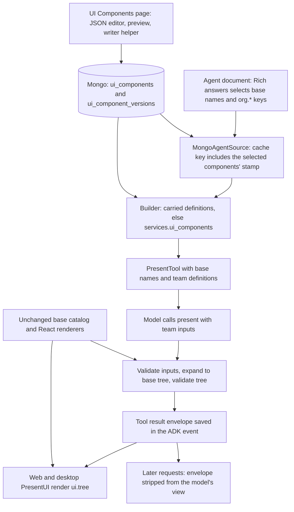

# Team Generative UI Components Design Brief

Status: Phases 1–3 shipped (the compiler and runtime protocol, the store and APIs, the runtime lookup and instruction writer). Phases 4–5 are not built: the UI Components settings page (library, editor, preview, publishing), the writer helper, the Rich answers picker with team groups, the pilot setting and general availability. Design revision 2.  
Date: October 18, 2026  
Scope: Organization settings, hosted APIs, agent runtime, web console, and desktop chat. Exported agents and workflow runs carry definitions; rendering in the standalone starter is out of scope.

## Decision

Every pre-coded generative UI component stays an unchanged base component. Teams make more components by writing compositions of those base components, as data. The definitions live in MongoDB as versioned documents, on the existing `VersionedDocumentStore`, under the owning organization. An agent's Rich answers node selects team components by key. When the hosted runtime builds the agent, it finds the selected definitions the same way it finds skills. The runner cache key includes a stamp of their live versions, so a publish takes effect on the next turn.

At run time, `present` validates each team node's inputs and expands it on the server into base nodes. The result is saved with the tool result. The client renders that base tree with the existing renderers. The model never sees the expanded tree again.

The feature needs one application and runtime release. After that, publishing a team component is a data change: no generated source, no frontend rebuild, no desktop reinstall, no Python redeploy. A new primitive or interaction that the base components can't express is still a code change.

In this design, **team means the existing `Organization` entity and its `organization_id` boundary**. There is no separate team ownership model. A person may belong to several organizations, so the person alone never selects which definitions apply. The target agent's stored organization does, after the runtime's existing admission checks.

## Goals and boundaries

Goals:

- Preserve all 36 base component definitions, renderers, names, defaults, styles, and action behavior.
- Add a **UI Components** page to organization settings: a library, a JSON editor with live preview, a writer helper that drafts a component from a description, version history, and publishing.
- Use the same definitions everywhere: the agent picker, the runtime's `present` schema and instructions, validation, the instruction writer, and the Forge assistant.
- Apply a publish on the next turn without changing a turn that's already running.
- Keep historical messages as they were when a component is edited, disabled, or archived.
- Render in web and desktop through their shared base renderers.

The first release supports compositions with bound inputs, three bounded template operators (`$each`, `$when`, `$format`), and the existing reply and form actions.

Not in the first release:

- Team-supplied JavaScript, JSX, HTML, CSS, network requests, or tool implementations. A component can display data from an agent's existing tools; the component never fetches anything.
- Team components inside other team components.
- A general expression language. There are no comparisons, arithmetic, or functions beyond the three operators.
- Per-component user or group permissions.
- The visual designer (palette, layout tree, property and binding inspectors). It's phase 2, built once real components show what teams make.
- Rendering rich answers in the standalone starter. Its vendored web has no `present` renderer today, for base components either.
- A per-organization enablement flag. The feature is opt-in by construction: no agent changes until someone selects a team component.
- A client protocol handshake. See [Older clients](#older-clients).

## Current implementation

| Area | What it does now | Change |
| --- | --- | --- |
| `apps/forge-web/src/components/forge/generative-ui/` (`catalog.ts`, `schemas/`, `library.ts`, `components/`) | The static base vocabulary and the renderer registry. | Unchanged. It stays the base layer and the only thing the client renders. |
| `apps/forge-web/scripts/generate-agent-schema.mjs` | Writes `present.catalog.json` from the base vocabulary. | Still base-only. It also refuses a base prop named `props` or starting with `$`, which are reserved for team nodes and template operators. |
| `forge_agent_runtime/present.py` | `present_schema()` and `_validator()` are `@cache`d by component names. `_validator()` uses the stock `Draft202012Validator` because "The schema is the package's own". `ACTING` is a module-level frozenset. `PresentTool.run_async()` answers `{"shown": true}`. | Team definitions travel with each tool instance. Team input schemas go through the bounded checker. Calls with team nodes answer with an expanded-tree envelope. Earlier envelopes are stripped from the model's view. |
| `forge_agent_runtime/build.py` | `_Builder.present()` builds `PresentTool(picked)` synchronously. The intake's `present_forms` reads `ACTING` (around line 335). | `present()` becomes async and looks definitions up the way `skill_tools()` does: carried first, then the organization's. The intake's `present_forms` stays base-only: it asks the model to compose a form for its own questions, which a team component's fixed form can't be. |
| Skills (the precedent) | The runtime's `SkillLibrary` protocol. The admin API's `OrganizationSkills` and `SkillStamps`. `MongoAgentSource` folds `#skills:<stamp>` into the cache key. The document's `skills` field carries bundles. `bundle()` fills it for exports and workflow runs. | Mirror each piece for UI components. |
| `forge_admin/adk_workflows/versioned_store.py` | `VersionedDocumentStore`: drafts that name their revision (a stale save raises the store's `conflict`), immutable published versions, `start_version()` from any version, and `discard_draft()`. | Subclass it as `UiComponentStore`. |
| `features/agents/lib/schema.ts` | `rich_answers.components` is the static base-name enum. | Accept `org.*` keys structurally and check them against the organization's catalog. |
| `PresentUI` (`present-ui.tsx`) | Renders `props.args` once `shownOf(result)` isn't false. `renderGenerativeUI` logs an unknown component and renders nothing for it. | Read the envelope's tree when there is one. |
| `instruction_writer/brief.py` | `_components()` uses the runtime's static `components_of()`. | Read the organization's team definitions too. |
| `starter/web_vendor/` | No `present` renderer; tool calls show through `tool-fallback`. | Unchanged in v1. |

## Architecture



The client never downloads or registers new React code. Team components exist only as definitions on the server. By the time anything reaches the client, it's a base tree.

One compiler, in the Python runtime package, handles definition checks, input validation, expansion, and expanded-tree validation. The designer's preview calls it through the admin API and renders the tree it returns. There is no second template interpreter in TypeScript.

## Ownership and caller scope

Definitions are always read for the target agent's own `organization_id`, after the runtime's existing locate, admit, and authorize steps. Nothing in this feature picks an organization from the caller.

| Entry point | Organization used |
| --- | --- |
| Organization settings and the agent builder | The path's `organization_id`, authorized through the existing scoped checks before any read. |
| Signed-in runtime caller, organization API key, public chat page | The target agent's stored organization, as `admit_agent()`, `admit_call()` and `admit_page()` already establish it. Public pages expose no catalog: only the rendered result of the call. |
| Saved sub-agent | The child's own document. The executor already refuses a child from another organization, so it's the parent's organization. |
| Export or workflow run | The definitions `bundle()` carried in the document's `ui_components`. Nothing queries the hosted store from there. |
| Hosted agent document | Always the organization's live definitions. `checked_document()` drops a carried `ui_components` on save, as it drops `dependencies`. An imported or hand-edited document can't override the organization's components, and someone with `agents:manage` can't bypass `ui_components:manage`. |

Team components are added beside the base catalog, never in place of it:

- Base names such as `Card`, `Table` and `Choices` stay reserved.
- Team keys are immutable and namespaced, like `org.shipment-summary`. Display names can change.
- A team can't replace a base definition, change its schema, or supply a renderer.
- The same key in two organizations means two separate definitions.
- Drafts, disabled components and archived components never reach a build.
- A selected key that doesn't resolve is an explicit build error. It's never replaced by a similarly named base or another organization's component.

## Component definition contract

A definition has a stable key, a display name, a description of when to use it (at most 300 characters), an input JSON Schema, a template of base components, and example inputs. The store owns the organization, ID, version and publication state; neither the editor nor the agent sets them.

```json
{
  "format": "forge.ui_component/v1",
  "key": "org.shipment-summary",
  "display_name": "Shipment summary",
  "description": "Show an order's shipping status, its line items and the expected delivery date.",
  "input_schema": {
    "type": "object",
    "properties": {
      "order_number": { "type": "string", "maxLength": 80 },
      "status": { "type": "string", "enum": ["Packed", "Shipped", "Delivered"] },
      "delivery_date": { "type": "string", "maxLength": 80 },
      "delay_reason": { "type": "string", "maxLength": 200 },
      "line_items": {
        "type": "array",
        "maxItems": 20,
        "items": {
          "type": "object",
          "properties": {
            "name": { "type": "string", "maxLength": 120 },
            "quantity": { "type": "integer", "minimum": 1, "maximum": 9999 }
          },
          "required": ["name", "quantity"],
          "additionalProperties": false
        }
      }
    },
    "required": ["order_number", "status", "delivery_date", "line_items"],
    "additionalProperties": false
  },
  "template": {
    "_type": "Card",
    "title": { "$format": "Order {/order_number}" },
    "children": [
      { "_type": "Badge", "value": { "$bind": "/status" } },
      { "_type": "Fact", "label": "Expected delivery", "value": { "$bind": "/delivery_date" } },
      { "_type": "Alert", "$when": "/delay_reason", "title": "Delayed", "description": { "$bind": "/delay_reason" } },
      {
        "_type": "ListView",
        "children": {
          "$each": "/line_items",
          "max": 20,
          "template": { "_type": "ListViewItem", "children": [{ "$format": "{quantity} × {name}" }] }
        }
      },
      {
        "_type": "Button",
        "label": "Track delivery",
        "_action": { "type": "reply", "text": { "$format": "Track order {/order_number}" } }
      }
    ]
  },
  "examples": [
    {
      "order_number": "A-1042",
      "status": "Shipped",
      "delivery_date": "October 22",
      "line_items": [{ "name": "Desk lamp", "quantity": 2 }]
    }
  ]
}
```

Every prop in the example is a real base prop. The compiler checks every template against the base catalog.

The model calls a team component with an input envelope, so team inputs never mix with base props in the flat schema:

```json
{
  "_type": "org.shipment-summary",
  "props": {
    "order_number": "A-1042",
    "status": "Shipped",
    "delivery_date": "October 22",
    "line_items": [{ "name": "Desk lamp", "quantity": 2 }]
  }
}
```

Base calls keep their format, such as `{"_type":"Fact","label":"Orders","value":"12"}`. A call can mix base and selected team nodes: a team node can appear in a base layout's `children`. A team node's layout comes entirely from its published template. The call can't set its `children`, `_action`, or the types inside it.

### Template operators

Each operator follows A2UI's data-binding rules: JSON Pointer paths, paths relative to the current item inside a repeated template, and a cap on how many items a template repeats. The installed `@assistant-ui/generative-ui` implements those rules for its A2UI adapter. Here they're spelled as `$` operators inside Forge's nested tree rather than A2UI's flat component list, so a template has the same shape as a `present` call.

| Operator | Where it may appear | Meaning |
| --- | --- | --- |
| `{"$bind": "/pointer"}` | A prop value, or `_action.text`. | The value at that pointer in the validated `props`, copied with its type, including arrays for Table `rows`, Chart data, Steps `steps`, Timeline `items` and Choices `options`. |
| `{"$format": "text {/pointer}"}` | A prop value, `_action.text`, or a string child. | Plain text with placeholders. Each placeholder must resolve to a string, number or boolean. A missing value is an error unless the placeholder is in an optional field marked `{/pointer?}`, which renders as empty. Formats don't nest. |
| `"$when": "/pointer"` | A key on a node inside a `children` list (not the root). | The node is included only when the value is present and isn't `null`, `false`, `""` or `[]`. There are no comparisons or negation. |
| `"children": {"$each": "/pointer", "max": N, "template": {…}}` | The value of `children`. | Repeats one node template over an array input. Inside the template, a pointer without a leading `/` (`name`) is relative to the item; `/x` stays absolute. `N` is at most 100, and the bound array's schema must declare `maxItems` ≤ `N`. |

Compilation rules:

- Input values are data. They're never read as operators, templates or nodes, however they're shaped.
- Node types, `_action.type`, and the structure of `children` lists come only from the template. Operators can't produce keys or `_type` values.
- Any other `$` key in a template is rejected. That includes `$type`, which the client accepts as an alias of `_type`.
- `$bind` doesn't fall back to JSON Schema `default`. A required pointer that's missing is an error. An optional one needs a `$when` on its node, or an explicit literal fallback: `{"$bind": "/x", "else": "—"}`.
- Templates use only known base names, their props, layout choices and existing actions. Styling stays within the base components and the application theme.
- Expansion reuses the existing Card/Form normalization and quiet-field behavior. Action-bearing controls are checked after normalization (`_dead_buttons`), so composed forms submit together and buttons don't go inert.
- The compiler derives capabilities from the template's node types: `has_choices`, `has_actions` (any acting component), and `has_forms`. These drive the dialect's instructions and the intake's form behavior. Authors can't declare them.

### Input schemas

Team input schemas are no longer "the package's own", so they never go through the stock validator. Every check, at publish and on every call, uses `forge_common.patterns.schema_errors`, which has a time budget, a depth backstop, offline `$ref` handling and a regex size guard. On top of that, the compiler allows only a subset of JSON Schema:

- Allowed:
  - `object` with `properties`, `required`, and `additionalProperties: false`, which is required.
  - `array` with `items`, `minItems` and `maxItems`.
  - `string` with `maxLength`, which is required unless the string has an `enum`, and `minLength`.
  - `integer` and `number` with `minimum` and `maximum`.
  - `boolean`.
  - `enum`, and `description`.
- Not in v1: `$ref`, `$defs`, `pattern`, `format`, combinators (`anyOf`, `oneOf`, `allOf`, `not`, `if`), recursion, and `default`.

### Limits

These start as server settings and get tested against real components before rollout:

| Limit | Value |
| --- | --- |
| Definition size | 64 KiB |
| Template | 200 nodes, 16 levels |
| `$each` | At most 100 items |
| Expanded tree | 64 KiB, 500 nodes |
| Description | 300 characters |

Exceeding a limit is an error with a field path. Nothing is truncated.

## Persistence and publication

`UiComponentStore(VersionedDocumentStore)` keeps the definitions:

- **Collections:** `ui_components` for records and `ui_component_versions` for published versions (`uic_…@N`).
- **IDs:** `id_prefix = "uic_"`, `noun = "component"`.
- **`checked()`:** checks the document against `forge.ui_component/v1`'s structure. A draft can be incomplete.
- **Publish:** the publish route runs the compiler's full check first, because `VersionedDocumentStore.publish()` says "Check it can be published first: this doesn't." The check covers the input schema subset, every pointer, base names and props, limits, and every example. Publishing takes the revision the editor showed, so a draft saved since then raises `conflict` (409).
- **Unique keys:** an `extra_indexes` entry makes `(organization_id, document.key)` unique, across archived records too, so a key is never reused. Publishing refuses a key that differs from the record's.
- **Disable:** `set_disabled()` on the subclass, the way `ChatAgentStore.set_chat_page()` sets a record field. It's reversible.
- **Archive:** the store's soft delete (`deleted_at`). Reads never return archived records.
- **Rollback:** `start_version(from_version=n)`, then publish. That creates version N+1 from version n. Published versions never change; the store has no way to change them.

There is no SQL table, no per-organization settings record, and no organization-wide catalog revision. The only SQL change is migration `0034`, which adds the `ui_components:manage` permission.

Example inputs are configuration, not records of real runtime values. Runtime values stay in the conversation's existing storage.

### Versioning policy: agents use the latest version

An agent uses each selected component's live version from its next turn. Saved agents and skills already work that way ("Published parents may refer to the latest saved agents"). Because history renders from stored trees and each turn's prompt and schema come from the same build, any change is safe to publish at runtime, including changes to inputs. Publishing therefore allows any change to a component except its key.

Instead of a compatibility rule, publishing shows the agents it affects: those whose draft or latest published version selects the key. It's one query in the same MongoDB as `chat_agents` and `chat_agent_versions`. The dialog says their next turn uses the new inputs, because people's instructions or tools may describe the old ones.

Disabling or archiving a component shows the same list. Those agents fail to build with `component_unavailable` until their selection changes. A turn already running finishes with the definitions its runner captured. Historical messages keep rendering their stored trees.

Pinning component versions when an agent is published is the coherent alternative. It's deliberately not v1: it would need pins in the agent document and an "update pins" step in agent publishing.

### Permission

Migration `0034` adds `ui_components:manage` and grants it to the organization administrator role only. Existing roles can delegate it.

This differs on purpose from `skills:manage`, which migration `0025` grants to administrators and members. A component's description becomes prompt text in every agent that selects it, and its template is what end users see. Reading the live catalog needs `organizations:read`. Configuring and running agents keep `agents:manage` and `agents:run`.

## API design

All paths sit beneath the configured API prefix. Every lookup is scoped to the authorized organization, including lookups by ID.

| Method and path | Permission | Contract |
| --- | --- | --- |
| `GET /organizations/{organization_id}/ui-components/catalog` | `organizations:read` | The base catalog plus the organization's published, enabled team components: key, display name, description, input schema, capabilities, version. No templates. The ETag is a digest of the base catalog's digest, the organization, and each component's `(id, key, version)`. |
| `GET /organizations/{organization_id}/ui-components` | `ui_components:manage` | Management listing with draft, live and disabled state, and how many agents use each. |
| `POST /organizations/{organization_id}/ui-components` | `ui_components:manage` | Create a draft with a new `org.*` key. |
| `GET /organizations/{organization_id}/ui-components/{id}` | `ui_components:manage` | The record: draft or latest document, revision, published version. |
| `PUT /organizations/{organization_id}/ui-components/{id}/draft` | `ui_components:manage` | Save the draft from a revision. 409 if it's stale. |
| `POST /organizations/{organization_id}/ui-components/preview` | `ui_components:manage` | Compile a supplied definition with sample inputs. Returns the expanded tree and diagnostics. Nothing is saved or run. |
| `POST /organizations/{organization_id}/ui-components/{id}/publish` | `ui_components:manage` | Full check, then publish from a revision. Returns the new version and the affected agents. |
| `PATCH /organizations/{organization_id}/ui-components/{id}` | `ui_components:manage` | Disable or enable it: a record field, not a change to the component, so no revision. The display name is part of the definition and changes through a draft. |
| `DELETE /organizations/{organization_id}/ui-components/{id}` | `ui_components:manage` | Archive. |
| `GET /organizations/{organization_id}/ui-components/{id}/versions` and `…/versions/{version}` | `ui_components:manage` | List versions, or read one. |
| `POST /organizations/{organization_id}/ui-components/{id}/versions` | `ui_components:manage` | Start a new draft from a given version (restore). |
| `DELETE /organizations/{organization_id}/ui-components/{id}/draft` | `ui_components:manage` | Discard the draft: back to the latest published version. |
| `POST /organizations/{organization_id}/helpers/ui_component_writer` | `ui_components:manage` | The existing helper route; see [Writer helper](#writer-helper). |

Diagnostics carry a stable code and a field path, for example `component_unavailable`, `component_disabled`, `component_input_invalid`, `binding_missing`, `format_value_not_scalar`, `each_over_limit`, `operator_unsupported`, `base_component_unsupported`, and `input_schema_unsupported`. Invalid definitions and selections return `422`, stale writes `409`, and authorization failures the application's existing inaccessible-resource responses.

Client caches of the catalog are keyed by organization. Publishing invalidates that organization's catalog query.

## Runtime integration

### Finding definitions: the skills pattern

| Piece | Skills (exists) | UI components (new) |
| --- | --- | --- |
| Runtime protocol | `SkillLibrary`: `(ids, *, organization_id) → bundles`, raising `LookupError` | `UiComponentLibrary`: `(keys, *, organization_id) → definitions`, raising `LookupError` for missing or disabled keys |
| Carried copies | `ChatAgentDocument.skills`, `BundledSkills` | `ChatAgentDocument.ui_components` (key → definition with its version), which the builder reads directly; no bundled library is needed |
| Service | `RuntimeServices.skills` | `RuntimeServices.ui_components` |
| Builder | `skill_tools()` → `_skills()`: carried first, then the service | `present()` becomes async: carried first, then the service. A missing key, or a team key with no service, is a `BuildError`. Base-only selections never query. |
| Hosted lookup | `OrganizationSkills` | `OrganizationUiComponents`, reading `UiComponentStore`'s published versions |
| Cache key | `SkillStamps` → `#skills:<stamp>` in `MongoAgentSource.get()` | `UiComponentStamps` → `#ui:<stamp>`: a digest of the sorted `(key, published_version, disabled)` for the team keys the document selects. Empty for base-only agents. |
| Bundling | `bundle()` fills `skills` for exports and `RunResources` | `bundle()` fills `ui_components` the same way |

`AgentExecutor` doesn't change: the cache key comes from the source. Saved sub-agents are covered already. With source dependencies, each child resolves through `MongoAgentSource.get()` with its own stamps, and `_snapshot()`'s fingerprint includes each child's `cache_key`.

Consequences:

- A publish changes the stamp of exactly the agents that select that component. Their next turn, on any API process, builds with the new version. Other agents' runners stay cached.
- Draft saves don't change `published_version`, so autosaves never rebuild runners.
- The stamp is read before the build reads the definitions, as with skills. A publish in between gives a runner newer than its key. That's harmless: published versions only go up, so a stamp never returns to an earlier value, and the next turn rebuilds.
- A turn already running keeps its runner's definitions (`use_runner()` already holds it).
- If the store can't be read, the build fails with a clear error. It never falls back to base-only, and never to another organization's definitions.

Hosted agents always read the store, because `checked_document()` drops carried copies (see [Ownership](#ownership-and-caller-scope)). Exports and workflow runs carry definitions through `bundle()`. A workflow run's embedded agent therefore builds without the worker reaching the store, the same way its skills do.

### The `present` tool

- `PresentTool(components, definitions)`: base names still go through `components_of()`, and team definitions are held by the instance. For a set that includes team components, the schema and validator are built per instance; the `@cache` on `present_schema()` and `_validator()` is keyed by names and stays for base-only sets. Two organizations can use the same key.
- **Schema:** `_type`'s enum adds the selected team keys and their descriptions. A `props` property, an `anyOf` of the selected input schemas, goes on the node and on `$defs.node`. The schema keeps today's recursion through `$defs`. Check the declaration against each configured model provider before rollout.
- **Validation by `_type`:**
  - A team node may have only `_type` and `props`.
  - A base node may not have `props`.
  - A team node's `props` are checked with `schema_errors` against its own definition, never against whichever `anyOf` branch fits.
- **Expansion:** after validation, team nodes expand into base nodes. The whole expanded tree is then checked against the full base schema (all 36 components, since a composite may use ones the agent didn't pick) and for dead buttons, after Card/Form normalization.
- **Answer:**
  - A call with team nodes answers with the [envelope](#rendering-and-conversation-history).
  - A base-only call keeps `{"shown": true, "note": …}`.
  - Refusals keep their current shape and note.
- **Instructions:** `instruction_for()` keeps the Choices and action guidance for base components the model writes itself, and adds a team sentence: how to call `org.*` components, and that what the person picks or enters in one with controls or Choices comes back as their next message. The intake's `present_forms` stays base-only.
- **History:** `process_llm_request()` already runs on every model request, after ADK 2.10 has assembled the request's contents. Besides appending instructions, it replaces each earlier `present` function response that carries `ui` with a copy holding only `shown` and `note`. It builds new parts and never mutates the session event's own content. The saved event keeps the tree for replay; the model sees neither the tree nor the template. Without this, every team call would stay in context twice, and the model would see raw base trees and start imitating them.

The model sees team keys, descriptions and input schemas. It never sees templates. Descriptions are bounded metadata: they can't grant tool permissions or change the caller's scope.

### Instruction writer and Forge assistant

- `instruction_writer/brief.py`: `Resolved`, `resolve()`, `_components()` and `_tool_lines()` include the selected team components' descriptions, inputs and capabilities. `kit.py`'s `prepare()` supplies the organization's definitions from the authorized `HelperRun`. Unavailable selections appear as diagnostics in the brief rather than disappearing.
- `assistant/building_blocks.py`'s `building_blocks()` lists the organization's published team components. `assistant/agent_edits.py` checks Rich answers selections against them.

## Rendering and conversation history

A call with team nodes answers:

```json
{
  "shown": true,
  "note": "The person sees it now. This answer is for you alone: never quote it; reply in your own words.",
  "ui": {
    "protocol": 1,
    "components": [{ "key": "org.shipment-summary", "version": 3 }],
    "tree": {
      "_type": "Card",
      "title": "Order A-1042",
      "children": [
        { "_type": "Badge", "value": "Shipped" },
        { "_type": "Fact", "label": "Expected delivery", "value": "October 22" },
        { "_type": "ListView", "children": [{ "_type": "ListViewItem", "children": ["2 × Desk lamp"] }] },
        { "_type": "Button", "label": "Track delivery", "_action": { "type": "reply", "text": "Track order A-1042" } }
      ]
    }
  }
}
```

The client side:

- **`treeOf()`:** a new reader, `treeOf(args, result)` in `generative-ui/result.ts`, unwraps the result formats `shownOf()` already handles. For a supported `ui.protocol` it returns `ui.tree`. It falls back to `args` only for base-only calls. A call whose args contain a team key but whose result has no supported tree stays hidden while running and shows a short "can't be shown here" state when done. It never renders a team key as a base component.
- **`PresentUI`:** applies its existing form normalization and live/answered fieldset to that tree.
- **`offersChoices()`:** inspects the same tree, so a composition containing Choices still suppresses redundant follow-up chips.
- **`present-echo.ts`:** treats the larger answer as an echo too, so it's never shown as raw JSON.
- **Unchanged:** reply formatting, entered values, disabled historical controls, and lazy Diagram and Map loading.

The envelope is saved with the tool result in the conversation's existing ADK event and session storage. Streaming, session reload and conversation replay must keep it. Old messages render their stored tree without fetching today's definitions. Their content and structure stay as they were; ordinary theme and base-component updates can still change how they look.

### Older clients

There's no capability handshake. The reader ships in phase 1, before anyone can publish a team component. The web console is served fresh, and the desktop app (Tauri, bundling `forge-web/dist-desktop`) shipped on 2026-10-17, so there are no old installs to protect.

A client from before the reader renders `args`. `renderGenerativeUI` logs an unknown component and renders nothing for it, so a team node at the root draws nothing, and one inside a base layout is left out of it. The agent's own words still stand, because `present`'s instruction already requires a sentence or two beside every call.

API and A2A callers get the structured tool result as today. If the desktop app gains a real installed base before this ships, revisit a handshake then.

## Designer and agent configuration

**UI Components** goes under the organization workspace's **Settings** section (`view=ui-components`), with an organization-owned editor route for one component. The page is shown to people with `ui_components:manage`. A deployment setting can hide it during the pilot.

**Library:**

- Base: read-only reference cards showing each base component's props and examples.
- Team: display name, description, draft or live state, version, disabled state, and how many agents use it.
- A new component starts blank, from a copy of another team component, or from the writer helper.

**Editor (v1):**

- A JSON editor on CodeMirror, which `expression-field.tsx` already uses (add `@codemirror/lang-json`). It lints with the field-path diagnostics the preview endpoint returns.
- A sample-inputs editor seeded from the examples.
- A live preview: debounced calls to the preview endpoint, rendered by `PresentUI` over the returned tree. Its action dispatcher records simulated replies instead of sending messages or starting workflows.
- Version history with "restore into a new draft".
- A publish dialog with the check's results and the affected agents.

### Writer helper

`ui_component_writer` is a new entry in `helpers/helpers.yaml`:

- **Permission:** `ui_components:manage`.
- **Run:** `sync`.
- **Toolsets:** `organization` and a new `ui_component_vault`, defined beside the skill creator's `skill_vault` (`forge_admin/ui_components/writer.py`, mirroring `skills/creator.py`).
- **Hand-in:** `save_ui_component`. It runs the compiler and returns diagnostics, so the helper fixes its own output before it finishes.
- **What it writes:** from a description, a draft definition with examples. It never publishes.
- **Instruction:** includes the base catalog's descriptions and props from `present.catalog.json`.

### Agent picker

- The Rich answers picker groups Base and Team components and shows descriptions and capabilities.
- Its schema-cost estimate counts team descriptions and input schemas.
- While the catalog is loading or unavailable, stored selections are never deleted or silently unselected.
- `RichAnswerComponent` stays the static base-name union for the React registry. Agent configuration uses a `UiComponentKey` that accepts base names and `org.*` keys, checked against the API catalog.
- Dependency selection, intake form hints (`RICH_ANSWER_ACTING` in `intake-agent-fields.tsx`) and validation warnings use each component's capabilities.

**Phase 2:** the visual designer (palette, layout tree, property and binding inspectors), designed from the components teams have actually written.

## Impacted existing files

Paths are repository-relative. Each existing symbol below was checked against the working tree.

### Runtime package (`packages/python/agent-runtime/src/forge_agent_runtime/`)

| File | Symbols | Impact |
| --- | --- | --- |
| `present.py` | `PresentTool`, `present_schema`, `_validator`, `problems_of`, `instruction_for`, `components_of`, `ACTING` | Team definitions per instance; `schema_errors` for team inputs; dispatch by `_type`; envelope; history stripping in `process_llm_request()`; capability-driven instructions. The base reader and its caches stay for base-only sets. |
| `build.py` | `_Builder.present()`, `_Builder.skill_tools()` (pattern), intake `present_forms` | `present()` becomes async with carried-then-service lookup. |
| `services.py` | `RuntimeServices` | Add `ui_components: UiComponentLibrary \| None`. |
| `document.py` | `ChatAgentDocument`, `parse_document()` | Add the carried `ui_components` field next to `skills`; accept `org.*` keys in `components` structurally. |
| `chat_agent.schema.json` | Generated format | Regenerated for `org.*` keys and the carried field. |
| `present.catalog.json` | Generated base vocabulary | Stays base-only. |
| `server.py`, `a2a.py` | Run/session serialization, A2A adapters | Verify the envelope survives SSE, session reads and A2A. No catalog route. |
| `executor.py` | `AgentExecutor`, `_snapshot()` | No change: the cache key comes from the source, and child cache keys are already in the fingerprint. |

### Admin API (`apps/forge-admin-api/src/forge_admin/`)

| File | Symbols | Impact |
| --- | --- | --- |
| `adk_workflows/versioned_store.py` | `VersionedDocumentStore` | Reused as the base class; unchanged. |
| `chat_agents/source.py` | `MongoAgentSource`, `create_executor()` | Take `UiComponentStamps` beside `SkillStamps`; wire `OrganizationUiComponents` into `RuntimeServices`. |
| `chat_agents/store.py` | `checked_document()`, `ChatAgentStore` | Drop a carried `ui_components` on save, as with `dependencies` (phase 3). `using_components()` (phase 2) finds the agents whose draft or latest published version picks given keys. |
| `chat_agents/bundle.py` | `bundle()` | Carry `ui_components` for the whole saved-agent graph, as with `skills`. |
| `adk_workflows/resources.py` | `RunResources.chat_agent()` | Pass the definition finder to `bundle()`, as with skills. |
| `api/routes/chat_agents.py` | `save_draft()`, `publish_chat_agent()`, `check_builds()`, `export_version()`, `_standalone()` | Diagnostics for unavailable selections. `check_builds()` calls `build_app()` directly, so it needs `ui_components` in its services. Exports carry definitions. |
| `instruction_writer/brief.py`, `instruction_writer/kit.py` | `Resolved`, `resolve()`, `_components()`, `_tool_lines()`, `prepare()` | Team-aware components in the brief. |
| `assistant/building_blocks.py`, `assistant/agent_edits.py` | `building_blocks()`, Rich answers edit checks | Offer and check team components. |
| `helpers/helpers.yaml`, `helpers/registry.py` | Helper and toolset registry | Register `ui_component_writer` and `ui_component_vault`. |
| `api/app.py`, `api/server.py` | Router registration, service wiring | Register the routes; build the store. |
| `db/migrations/versions/` | Alembic | `0034`: the `ui_components:manage` permission and its grant to administrators. No tables. |
| `chat_agents/runtime.py`, `chat_agents/pages.py`, `auth/runtime_access.py` | `admit_agent()`, `admit_page()`, `admit_call()` and friends | No change; this feature relies on them as they are. |

### Frontend (`apps/forge-web/`)

| File or area | Symbols | Impact |
| --- | --- | --- |
| `src/components/forge/generative-ui/components/`, `library.ts`, `styles.css`, `catalog.ts`, `schemas/` | Base renderers, `LIBRARY`, base catalog | Unchanged. |
| `src/components/forge/generative-ui/present-ui.tsx`, `messages.ts` | `PresentUI`, `shownOf()`, `offersChoices()` | Use `treeOf()`; keep legacy calls and follow-up behavior. |
| `src/components/forge/assistant/present-echo.ts` | Echo filtering | Recognize the envelope. |
| `src/features/agents/components/tool-fields.tsx` | `RichAnswersFields` | Picker from the organization catalog. |
| `src/features/agents/components/intake-agent-fields.tsx` | `RICH_ANSWER_ACTING` use | Capabilities from the catalog. |
| `src/features/agents/lib/schema.ts`, `model.ts`, `validate.ts` | `rich_answers.components`, validation context | `UiComponentKey`; catalog-aware checks; keep selections while loading. |
| `src/features/organizations/lib/organization-workspace.ts`, `components/organization-workspace-nav.tsx` | `WORKSPACE_VIEWS`, navigation | Add UI Components under Settings. |
| `src/routes/organizations/$organizationId.tsx` | Workspace route | Mount the library view. |
| `src/features/conversations/components/conversation-replay.tsx` | Replay | Verify stored trees render without fetching definitions. |
| `scripts/generate-agent-schema.mjs` | Schema generation | Refuse reserved prop names; regenerate the agent schema. |
| `vite.desktop.config.ts`, `apps/forge-desktop/` | Desktop build | Ship the reader in phase 1. No component-specific native code. |

### New files

| Location | Contents |
| --- | --- |
| `packages/python/agent-runtime/src/forge_agent_runtime/generative_ui/definitions.py` | `UiComponentDefinition`: the `forge.ui_component/v1` format and the input-schema subset. |
| `packages/python/agent-runtime/src/forge_agent_runtime/generative_ui/compiler.py` | Operators, pointer scopes, limits, expansion, expanded-tree checks, capabilities. |
| `packages/python/agent-runtime/src/forge_agent_runtime/generative_ui/library.py` | `UiComponentLibrary` protocol, `team_keys()`, `is_team_key()`. |
| `apps/forge-admin-api/src/forge_admin/ui_components/store.py` | `UiComponentStore(VersionedDocumentStore)`, `set_disabled()`, `live()` (each published, enabled component's live definition). |
| `apps/forge-admin-api/src/forge_admin/ui_components/library.py` | `OrganizationUiComponents`, `UiComponentStamps`. |
| `apps/forge-admin-api/src/forge_admin/ui_components/writer.py` | The `ui_component_vault` toolset and its `save_ui_component` hand-in. |
| `apps/forge-admin-api/src/forge_admin/api/routes/ui_components.py` | Request and response models, scoped routes, preview. |
| `apps/forge-web/src/components/forge/generative-ui/result.ts` | Envelope reader and `treeOf()`. |
| `apps/forge-web/src/features/ui-components/lib/` | API client, organization-scoped queries, `UiComponentKey` and catalog types. |
| `apps/forge-web/src/features/ui-components/components/` | Library, JSON editor, sample inputs, preview, version history, publish dialog, writer entry point. |
| `apps/forge-web/src/routes/organizations/$organizationId_.ui-components.$componentId.tsx` | The editor route. |

## Rollout

1. **Phase 1:** the compiler, the runtime protocol and the reader; history stripping; `treeOf()` in web and desktop. It's verified with fixture definitions and no store.
2. **Phase 2:** the store, migration `0034`, scoped APIs and preview.
3. **Phase 3:** the builder lookup and stamps, the schema and instructions, `bundle()`, the instruction writer and the assistant.
4. **Phase 4:** the library, editor, writer helper and picker, behind the deployment setting for a pilot organization. Pilot with a display component, a Choices composition, a form composition and a list built with `$each`.
5. **Phase 5:** turn off the setting for every organization once the acceptance criteria pass.

Exports carry definitions from phase 3. In the standalone starter, a team call shows through the tool fallback, as base calls do today. Rendering there is a separate piece of work for base and team components alike.

## Validation and acceptance criteria

| Area | Required evidence |
| --- | --- |
| Base regression | Existing rich-answer rendering and action tests pass. The base catalog and renderers are unchanged. Base-only agents never query the store. |
| Tenant isolation | Two organizations publish the same key with different definitions. Catalogs, prompts, previews, runner cache keys and expanded trees stay separate, for API keys, people in several organizations, and public page tokens. A hosted document saved with a carried `ui_components` loses it. |
| Publication | A stale draft save or publish returns 409. Published versions never change. Restore creates a new version. Archived keys can't be reused. |
| Freshness | Publishing from one process changes the next turn on another. Publishing component A leaves the runners of agents that select only B cached. Draft autosaves rebuild nothing. A running turn keeps its definitions. |
| Dialect consistency | The picker, instruction writer, `present` declaration, validator and compiler see the same definitions. A team component with controls gets the team interaction sentence. |
| Model history | After a team call, the next model request contains no `ui` or tree for it, and the stored event still does. |
| Validation | Each of these fails with a field path: `props` on a base node; base props on a team node; wrong input types; unknown keys; a missing required pointer; a non-scalar `$format` value; `$each` over its cap or without `maxItems`; an unknown `$` key or `$type` in a template; invalid base props; deep or oversized trees. Bound values shaped like nodes stay data. |
| Bounded schemas | Schemas with `$ref`, `pattern`, `format` or combinators are refused at publish. A slow or deeply nested input is refused within the time budget. |
| Interactions | Choices, standalone date actions, nested forms, named values, reply formatting and disabling after an answer match current behavior. `$format` in `_action.text` sends the formatted text. Preview actions stay simulated. |
| History | A stored team result replays identically in structure and content after later versions, disabling, archiving and application reload. Choices follow-up suppression still works. |
| Clients | Web and desktop render the same expanded tree. A client without the reader degrades as described in [Older clients](#older-clients). Lazy Map and Diagram rendering still works. |
| Portability | Exports and workflow runs carry the definitions of the whole saved-agent graph and build without the store. |
| Failure behavior | A missing selected definition, or an unreadable store, fails the build explicitly. There's no base-only downgrade or cross-tenant fallback. |

Tests to extend:

- **Runtime:** `packages/python/agent-runtime/tests/test_present.py`, `test_document.py`, `test_build.py`, `test_executor_cache.py`, `test_server.py`, `test_a2a.py` and `test_starter.py`, plus new compiler and library tests.
- **Admin API:** store, stamp, route-authorization, bundle and migration tests under `apps/forge-admin-api/tests/`, plus `tests/instruction_writer/` and the chat-agent export and runtime tests.
- **Frontend:** `assistant-rich-answers*.test.mjs`, the agent catalog and validation tests, and browser tests for the editor, preview and result replay.

The feature is complete when a team administrator can write or generate a component, preview and publish it, and select it for an agent, and the next authorized turn renders it in web and desktop with no code deployment. Base components, other organizations, and earlier conversation content must stay unaffected.

## Implementation sequence

| Phase | Deliverable | Exit condition |
| --- | --- | --- |
| 1 | Definition format, compiler, runtime protocol, history stripping, result reader in web and desktop | Base regressions pass. A fixture composite with `$each`, `$when` and `$format` expands and renders with no store. The model never sees the tree. |
| 2 | `UiComponentStore`, migration `0034`, scoped APIs, preview | Tenant, publication and authorization tests pass. Preview and runtime share the compiler. |
| 3 | Builder lookup, stamps, schema and instructions, `bundle()`, instruction writer, assistant | A publish changes the next turn across processes, and only for agents that select the component. Running turns and history stay stable. |
| 4 | Library, JSON editor, preview, writer helper, picker | A pilot administrator writes or generates, previews, publishes and selects a component through the UI. |
| 5 | Pilot acceptance, then general availability | All acceptance criteria pass. |

The limits, the administrator-only grant, and base-only nesting are first-release defaults. They can change without changing the architecture: unchanged base components, plus organization-owned definitions found the way skills are and expanded on the server.
